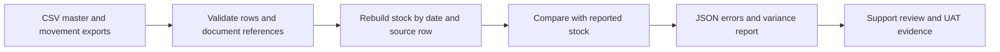

# ERP Support Toolkit

**Read-only master-data validation and inventory reconciliation in Python.**

A personal portfolio project for ERP Support / Testing Intern applications. It demonstrates how to inspect an import file, explain data-quality issues to business users, reconcile stock against source documents, and prepare UAT evidence. It is vendor-neutral practice, not an SAP/Odoo implementation or client engagement.

## See the result in two minutes

Python 3.12+; no third-party runtime packages, credentials, or ERP access required.

```bash
git clone https://github.com/boyhoanghoi/erp-support-toolkit.git
cd erp-support-toolkit
python -m erp_support --products samples/products.csv --movements samples/movements.csv --out reports/clean.json
python -m unittest discover -s tests -v
```

The clean sample produces `PASS: 2 products, 4 movements, 0 errors, 0 variances`.
Try a deliberately dirty master file:

```bash
python -m erp_support --products samples/products-with-issues.csv --movements samples/movements.csv --out reports/review.json
```

This command intentionally exits with **1** and produces `REVIEW_REQUIRED`. See [actual sample outputs](docs/sample-results.md).

## What this demonstrates

| Business question | Implemented check | Evidence |
| --- | --- | --- |
| Can the master be imported safely? | Required headers, unique SKU, product name, finite price, integer stock | `erp_support/checks.py`, validation tests |
| Are movement documents valid? | Unique IDs, known SKU, ISO date, nonzero quantity, document reference | Row-level error codes in JSON |
| Does system stock agree with the ledger? | Opening + signed movements = expected stock; current - expected = difference | Per-SKU balance and variance count |
| Can a bad input produce a misleading sign-off? | Reports with validation errors set `reliable=false` | Negative tests and CLI warning |
| Can support reproduce and escalate an issue? | Sample files, UAT cases, support triage and read-only SQL | [UAT](docs/uat.md), [runbook](docs/support-runbook.md) |



## Input contract

- CSV encoding: UTF-8, optional BOM; extra named columns are allowed. Missing/duplicate headers and ragged rows fail with exit code 2.
- Products: `sku,name,unit_price,opening_stock,current_stock`. SKU uses 2-40 uppercase letters/digits/underscore/hyphen. Price is nonnegative and has at most two decimal places. Stock is a nonnegative integer.
- Movements: `movement_id,sku,business_date,delta,reference`. Positive delta receives stock, negative delta issues it; cancellation is a positive reversal. Each movement needs a unique ID and document reference.
- Supply **all movements between the opening balance and current-stock snapshot**, for one warehouse and one unit of measure. Dates sort chronologically; same-day ties retain input row order. The tool cannot detect omitted documents or a wrong export window.
- No movements is valid when opening and current stock agree. An empty product master is not valid.
- Validation errors make all balances **provisional**, because excluded rows may change totals. A clean report supports investigation; it does not certify source-data completeness.

Exit codes: `0` clean and balanced; `1` validation errors or variance; `2` usage / file / format errors. Input files are never modified. An output path equal to either input is rejected.

## Portfolio walkthrough

1. Run the clean sample and explain `10 - 4 + 1 = 7` for `KB-01`.
2. Run the dirty sample: identify a duplicate SKU, invalid price, missing name, negative stock, and a stock variance.
3. Use the [support runbook](docs/support-runbook.md) to separate an export-window problem from an invalid master row.
4. Discuss why a stock variance must be investigated before any ERP adjustment.

Related backend project: [OrderFlow](https://github.com/boyhoanghoi/orderflow), with transactional stock movements, JWT roles and reconciliation endpoints. The CSV samples here are standalone training data, not an automatic export from OrderFlow.

## Scope and next steps

Local batch analysis only. No ERP writes, vendor connectors, multi-warehouse conversion, costing, or accounting entries. Future work: warehouse/unit keys, configurable mapping, and a connector tested against a real sandbox. Automated checks run in GitHub Actions; UAT cases are training scenarios, not customer sign-off.
